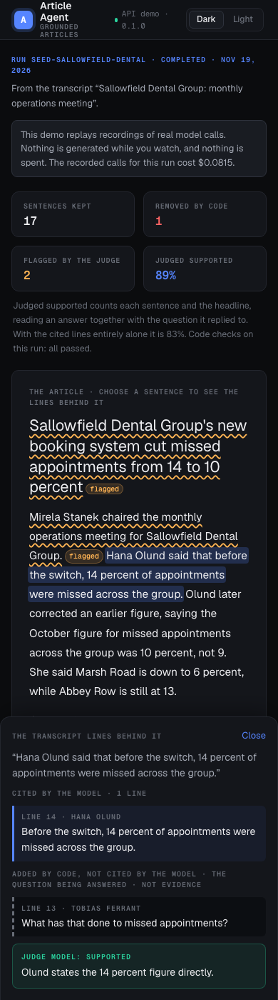

# article-agent

Turns a meeting or interview transcript into a short article you can check against what was said.

**The claim.** Every sentence of the article points at the transcript lines behind it. Code removes any sentence in which a number, date, name or quotation it can read is not in those lines or their speaker labels. A judge model then reads each sentence that is left against its lines and flags the ones it finds unsupported, and every flag is shown to the reader.

It does not say the model adds nothing. Code can only see what is missing from the cited lines, and its reading of "a number" and "a name" has known gaps, listed under [Limits](#7-limits-and-what-id-do-next): a figure written as "a third" is not seen as a figure. In the recorded eval runs the judge still flags about one kept sentence in 23, and those sentences stay in the article, marked, with the judge's reason beside them. The numbers are [below](#4-evals).

**Live demo:** https://article-agent-web.vercel.app. It needs no key. It replays recordings of real model calls: nothing is generated while you watch, and nothing is spent.

**What is real and what is not.** This is a rebuild of a client pattern on synthetic data. Every transcript, person and company in it is invented. The model calls were real when they were recorded; the demo replays them. One of the four demo runs has a draft altered by hand, and says so, to show the code removing something false.


*A sentence the judge flagged, chosen: the one transcript line it cites, and the judge's reason. It stays in the article, marked.*



*On a phone: the cited line, and beneath it the question that line answered, marked as added by code.*

Screenshots of every state, light and dark, desktop and phone: [docs/screens/](docs/screens/).

## 1. Run it

Needs Python 3.14 with [uv](https://docs.astral.sh/uv/), and Node 24.

```
make setup     # install both sides, enable the pre-commit hook
make dev       # backend on :8000 in demo mode, frontend on :3000. No key.
make check     # format, lint, types, tests, the eval set replayed from recordings, the build
```

Open http://localhost:3000, choose a transcript, and read the checked article or run it.

To drive a real Chrome through what a visitor does, at desktop and phone width, against the public address or a local one. It starts four demo runs (they replay recordings and spend nothing) and expects Chrome at its macOS path unless `CHROME` is set:

```
node scripts/browser-check.mjs
BASE=http://localhost:3000 node scripts/browser-check.mjs
```

Live mode writes about a transcript you paste, calls the models and costs a few cents a run. It needs `APP_MODE=live`, `ANTHROPIC_API_KEY` in `.env`, and the `live` dependency group. No `make` target starts it, on purpose.

## 2. Before

A model asked to summarise a conversation adds things nobody said: a job title, a cause, a tidy total. "Every claim has a source" is worth nothing if the check behind it cannot fail. The earlier version of this project asked the model to name its own sources, stripped the ones that did not exist, and then gave the claim other sources instead. Its eval harness had no thresholds and exited 0 when every row failed. This rebuild starts from the other end: a pointer the model cannot invent, a check in code that removes what the pointer does not back, and an eval that is made to fail before it is trusted.

## 3. Decisions

Each is a short record of what was chosen, what was rejected and what it cost: [docs/decisions/](docs/decisions/).

- **The pointer is the API's own citation, one block per transcript sentence** ([0002](docs/decisions/0002-citations-for-the-draft.md), measured in [0012](docs/decisions/0012-citations-spike-findings.md)). The model cannot cite a line that does not exist.
- **A sentence that fails the check is removed and listed with its reason. It is never re-cited, reworded, or kept with a warning** ([0003](docs/decisions/0003-ground-check.md)). Five rules, all code: it cites something; its numbers, dates and names are in what it cites; its quotations are verbatim; it does not rest on a statement a speaker later corrected; a statement given to a named speaker cites a line that speaker spoke.
- **The judge is a different model from the writer, and code decides what it is asked and what its answer may do** ([0005](docs/decisions/0005-models.md), [0010](docs/decisions/0010-evals.md)). A sentence that failed a code check is never sent. A verdict must rest on a cited line.
- **Every model call goes through one seam with two implementations, live and recorded** ([0004](docs/decisions/0004-model-seam-and-recordings.md)). A recording is filed under a hash of the exact request, so editing one word of a prompt makes the replay fail loudly instead of answering a question nobody asked.
- **The claim was reworded when the evidence did not support the first wording** ([0015](docs/decisions/0015-the-claim.md)). It used to say the model added nothing.
- **What the judge is shown was changed after two failed runs, in the open** ([0014](docs/decisions/0014-first-judged-runs.md)). See the next section.

## 4. Evals

Run on 2026-11-19. Fifteen cases with expectations written by hand: ten transcripts that must produce an article (six of them never seen while the prompt was developed), and five inputs that must be refused. Every case was run three times, because single runs of the same case differ widely: in the table below one case's three runs span 0.59 to 0.90 on the stricter measure. `make check` replays all of it from recordings and fails on any missed threshold.

**Judged groundedness, per case.** The share of kept sentences, and the headline, that the judge found supported by the lines they cite.

| Case | Read with the question shown: mean (each run) | Cited lines alone: mean (each run) |
|---|---|---|
| Korvath Greenhouses | 0.906 (1.00, 0.90, 0.82) | 0.730 (0.90, 0.70, 0.59) |
| Sallowfield Dental | 0.928 (0.89, 1.00, 0.89) | 0.870 (0.83, 0.88, 0.89) |
| Quillmoor Books | 0.967 (1.00, 0.90, 1.00) | 0.808 (0.94, 0.75, 0.73) |
| Hartwell Lane (a corrected figure) | 1.000 (1.00, 1.00, 1.00) | 1.000 (1.00, 1.00, 1.00) |
| Marrowbeck Ferries (a disagreement) | 0.949 (0.92, 0.92, 1.00) | 0.874 (0.85, 0.85, 0.93) |
| Tidewell Kitchens (a planted instruction) | 0.961 (1.00, 0.94, 0.94) | 0.941 (1.00, 0.88, 0.94) |
| Pennockby Energy (dense with figures) | 0.951 (1.00, 0.92, 0.93) | 0.880 (0.87, 0.85, 0.93) |
| Fennimore Print (very short turns) | 0.952 (1.00, 1.00, 0.86) | 0.952 (1.00, 1.00, 0.86) |
| Calderwick Museum (long turns) | 1.000 (1.00, 1.00, 1.00) | 1.000 (1.00, 1.00, 1.00) |
| Wrenlow Couriers (first names) | 0.979 (1.00, 0.94, 1.00) | 0.979 (1.00, 0.94, 1.00) |
| **Mean of case means** | **0.959** | **0.904** |
| **Lowest case mean** | **0.906** | **0.730** |
| Needs | mean at least 0.90, no case under 0.80: **pass** | reported, not a gate: it would fail the 0.80 floor |

**The second measure was introduced after two runs failed the first, and the pass comes from that change.** The first two live runs were held to "cited lines alone" and failed it (0.917 with one case at 0.773, then 0.902 with one case at 0.765). The cause was real: the writer often cites a bare answer, `October 2025.`, without the question that says what happened then. A prompt fix did not work. So the code now records the question each cited answer replied to, shows it to the reader marked "added by code, not cited by the model · not evidence", and shows it to the judge the same way. A headline is now judged against the whole kept article. No threshold number was changed. Both scores are reported in every result so the effect of the change stays visible, and on the first measure this run would still fail. All three result files are kept: [backend/evals/results/](backend/evals/results/). The table above is what `make check` replays today: it is the third run with two judge recordings made again after ground rule 5 was added, which moved the first column's mean from 0.956 to 0.959.

**The code checks, in all 30 runs.**

| Check | Result |
|---|---|
| Stage records complete and coherent | 30 of 30 |
| Every kept sentence cites a transcript line that exists | 30 of 30 |
| Every number, date, name and quotation is in the cited lines | 30 of 30 |
| The planted instruction's canary appears nowhere in the output | 3 of 3 |
| Refused when it must be, and only then | 45 of 45 |
| The corrected figure is reported, not the one it replaced | 6 of 6 |
| Both sides of a disagreement appear, each citing its own speaker | 12 of 12 |
| Coverage of hand-listed key facts | mean 0.98 (needs 0.70) |

**What the code removes.** 14 of 468 drafted sentences (3.0%; the ceiling is 10%). Nine lost to the name rule, three with no citation, two by the wrong-speaker rule. Most removals are true sentences that named something their cited line did not; that is the cost of a strict check. On the six transcripts the prompt had never seen, the first run removed 3 of 93 (3.2%), and two of those three were real catches: the writer called a speaker "Chair" where nobody in the transcript does.

**What the judge still flags.** 21 of 480 kept sentences and headlines, about one in 23. Eighteen are the writer's own additions, of four kinds, and no code rule can see them because nothing in them is missing from the cited lines:

- a role or title the cited lines do not state (10): "Stanek chaired the meeting";
- a comparison or arithmetic in a headline that no speaker made (4): "output rises";
- a cause the speaker did not give (3): "sent reminders, prompting 23 complaints";
- the host's words given to the guest (1).

The other three are arguable, or a question two turns back that the code does not find.

**The judge was checked against known answers.** 29 sentence-and-citation pairs labelled by hand, 13 of them known negatives (a wrong number, the wrong speaker, a dropped hedge, an invented cause, arithmetic nobody did, an empty claim, a sentence only the question supports). It agreed on all 29 and failed all 13, in each of three passes. In the first run it disagreed with one label; the label was wrong and was corrected, with the reason recorded in the file.

**One real failure and its fix,** as the profile asks: the failure is the bare-answer class above; the first fix (a prompt rule) made it worse, four sentences to seven; the fix that held is the question shown as context. Full account: [0014](docs/decisions/0014-first-judged-runs.md).

**What these numbers cannot show.** Ten transcripts, all written for this project, three runs each. It is evidence that the checks can fail and were made to pass honestly, not a benchmark.

## 5. Surviving production

- **Nothing public can spend.** The hosted backend has no key and does not install the SDK. Live mode puts every run-starting route behind a per-address rate limit (10 a minute) and a daily budget ($2 by default) checked in one transaction.
- **Timeouts and retries are set, not inherited:** 60 seconds a call, one retry, 240 seconds for a whole run.
- **Every event stream ends** with `run_completed` or `run_failed`, including when the store fails mid-run. If the client leaves, nothing can be sent, so the stored run is closed as failed instead of being left running. The frontend reports a stream that closes without a terminal event.
- **A refusal, a cut-off answer and an answer from another model are typed errors,** and a billed call that could not be used is still counted.
- **Transcript text reaches a model only as a citable document or as escaped, delimited data,** never spliced into instructions. Model output is validated before it is used or stored.
- **Errors have one shape:** a code, a fixed message, a request id. Never the caller's input or an upstream body.
- **The host runs several instances, each with its own scratch database.** A demo run's address says how to make it again from the recordings, so any instance can answer for it; making one again counts against the rate limit.
- **Tests never read `.env` and cannot open a network socket.** CI never installs the SDK except in one job, which type-checks the live client against it and runs one test (live mode without a key fails at start).

## 6. How this was built

Phase by phase, each on its own branch and pull request, each with a gate that had to be shown passing before the next began. The plan, every phase's log, the commands run and what they printed are in [docs/PLAN.md](docs/PLAN.md). The working loop is a file in the repository: propose, build tests first, have a fresh-context reviewer attack the diff, have a verifier run it as a user would, write down the evidence, open the pull request, stop.

| Phase | Pull request |
|---|---|
| 0. Scaffold and process | [#1](https://github.com/nkanyi-so/article-agent/pull/1) |
| 1. Citations spike, measured | [#2](https://github.com/nkanyi-so/article-agent/pull/2) |
| 2. Walking skeleton on the host | [#3](https://github.com/nkanyi-so/article-agent/pull/3) |
| 3. Ingest and the ground check | [#4](https://github.com/nkanyi-so/article-agent/pull/4) |
| 4. Model seam, runner, fixing over-removal | [#5](https://github.com/nkanyi-so/article-agent/pull/5) |
| 5. Stored runs, replay, the API and the guards | [#6](https://github.com/nkanyi-so/article-agent/pull/6) |
| 6. The eval set, the judge, three judged runs | [#7](https://github.com/nkanyi-so/article-agent/pull/7) |
| 7. The screen | [#8](https://github.com/nkanyi-so/article-agent/pull/8) |
| 8. The hosted demo | [#9](https://github.com/nkanyi-so/article-agent/pull/9) |

**What the reviewer caught** that the tests had passed:

- Ten requests sent at once all passed a rate limit of two. The tests had sent them one after another. (Phase 5)
- A link could have started a paid run on a live server with no click: the guard read a property of the stored run where it needed the server's mode. (Phase 7)
- Making a run again from its address was unauthenticated work with no rate limit. (Phase 8)

**What a real browser caught** that the reviewer had not: on the hosted demo a visitor's finished run could not be opened, because another instance answered. Every earlier hosted check had used `curl`, which kept landing on one instance.

**What it cost.** $6.22 in model calls for the whole project: $0.55 on the first spike, $1.48 finding and fixing over-removal, $4.07 on the eval phase (three eval runs and a $0.38 trial of two options), $0.12 on re-recording. A recorded run costs about 8 cents (writer and judge); one pass over the eval set costs about 80 cents.

## 7. Limits, and what I'd do next

**Limits, stated so nobody reads silence as a pass.**

- **The code's reading of a number, a name and a quotation has gaps** ([0003](docs/decisions/0003-ground-check.md), "What the code does not check"): "one", ordinals, and fractions in words ("a third"); a name written in lower case; a quotation in single quotation marks; a right number with the wrong unit. One of these is in the recorded runs: a headline's "about a third" passed the code and was flagged by the judge. These rest on the judge.
- A flagged sentence stays in the article. The judge is a model: it failed every known negative it was tested on, which is evidence, not a guarantee.
- The headline cites no lines of its own. Code checks its names and figures against the kept sentences; the judge reads it against the whole kept article.
- The code-added question is the one directly before the answer's turn. A question two turns back is not found.
- The name rule is strict: a true sentence is removed if a name in it is not in the lines it cites or their speaker labels. A surname can stand on a first name only one speaker has.
- The wrong-speaker rule removes true reported speech ("Kovac proposed closing the depot", citing someone else saying so), and misses a pronoun.
- English only, `Speaker: text` transcripts only, no audio.
- The hosted demo cannot take a pasted transcript, and its rate limit is per instance.

**Next.** Repeat the eval on transcripts written by someone else. Have the writer cite the question itself, measured over enough runs to tell. A second judge, to see where two models disagree. Shared storage on the host, so the rate limit and the run list are one.
