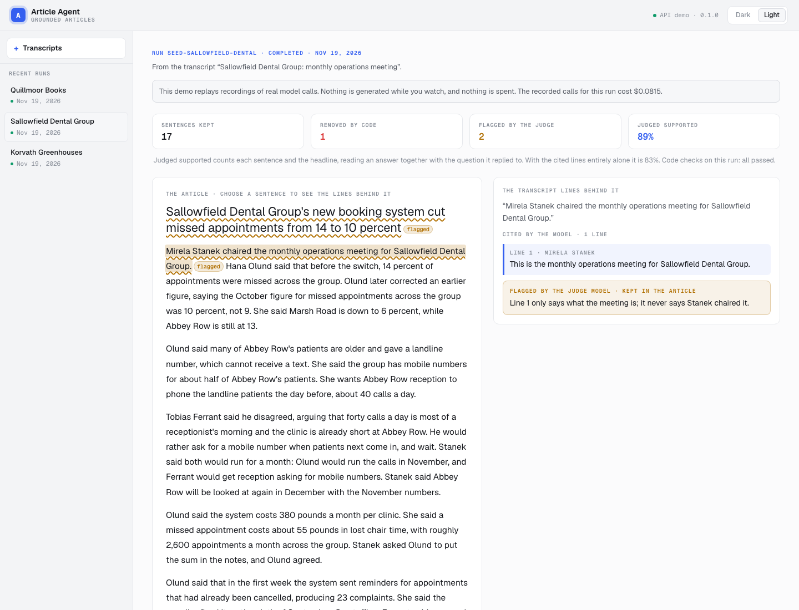
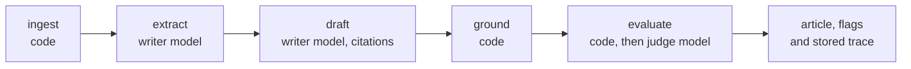

# article-agent

Turns a meeting or interview transcript into a short article in which every sentence can be checked against what was said.

**Live demo:** https://article-agent-web.vercel.app. It replays recordings of real model calls, so it needs no key and spends nothing. Every transcript, person and company in it is invented. One of the four demo runs has a draft altered by hand, and says so, to show the code removing something false.



## The point

Every sentence of the article points at the transcript lines behind it. Code removes any sentence in which a number, date, name or quotation it can read is not in those lines or their speaker labels. A judge model then reads each sentence that is left against its lines and flags the ones it finds unsupported, and every flag is shown to the reader. It does not say the model adds nothing: code can only see what is missing from the cited lines, and a sentence the judge flags stays in the article, marked.

## How it works



1. **Ingest** splits the transcript into sentences, each a citable block, or refuses an input it cannot use.
2. **Extract** asks the writer model for the points, corrections and disagreements, as structured output.
3. **Draft** has the writer model write the article with the API's own citations, so it cannot cite a line that does not exist.
4. **Ground**, in code, removes a sentence that cites nothing, has a number, date or name missing from its cited lines, misquotes, rests on a statement a speaker later corrected, or gives a statement to a speaker whose line it does not cite. It is listed with its reason, never re-cited or reworded.
5. **Evaluate** runs the code checks, then sends each kept sentence with its lines to the judge, a different model from the writer. Every stage is stored and can be re-run.

Every model call goes through one interface, live or recorded. A recording is filed under a hash of the exact request, so an edited prompt fails the replay loudly. See [ARCHITECTURE.md](docs/ARCHITECTURE.md) and [decisions/](docs/decisions/).

## Results

Judged groundedness: the share of kept sentences, and the headline, that the judge found supported by the lines they cite. `make check` replays the eval set from recordings and fails on a missed threshold.

| | Read with the question shown | Cited lines alone |
|---|---|---|
| Mean of case means | 0.959 | 0.904 |
| Lowest case mean | 0.906 | 0.730 |

The thresholds are a mean of at least 0.90 and no case under 0.80. "Read with the question shown" is the second measure: it was introduced after two runs failed the first, cited lines alone, and the pass comes from that change. The code now shows the judge, and the reader, the question each cited answer replied to, marked as not evidence. No threshold number was changed, and on cited lines alone this run would still fail the 0.80 floor. These are ten transcripts, all written for this project, three runs each: evidence that the checks can fail and were made to pass honestly, not a benchmark. Full detail: [docs/EVALS.md](docs/EVALS.md).

## Run it

Needs Python 3.14 with [uv](https://docs.astral.sh/uv/), and Node 24.

```
make setup     # install both sides, enable the pre-commit hook
make dev       # backend on :8000 in demo mode, frontend on :3000. No key.
make check     # format, lint, types, tests, the eval set replayed from recordings, the build
```

Then open http://localhost:3000. `node scripts/browser-check.mjs` drives a real Chrome through what a visitor does.

Live mode, for a pasted transcript, costs a few cents a run. It needs `APP_MODE=live`, `ANTHROPIC_API_KEY` in `.env` and the `live` dependency group. No `make` target starts it.

## Production notes

- **Spend:** the hosted backend has no key and does not install the SDK. Live mode puts every run-starting route behind a per-address rate limit (10 a minute) and a daily budget ($2 by default).
- **Auth:** there are no accounts. The hosted demo takes only the seeded transcripts.
- **Failure handling:** 60 seconds a call, one retry, 240 seconds a run. Every event stream ends with `run_completed` or `run_failed`.
- **Untrusted input:** transcript text reaches a model only as a citable document or as escaped, delimited data. Model output is validated before use.
- **Tests** never read `.env` and cannot open a network socket.
- **Known limits:** the code does not read "a third", ordinals or a name in lower case, so those rest on the judge. English `Speaker: text` transcripts only.

## How it was built

Built with AI assistance (Claude Code) under checks I set: a plan reviewed before any code, tests first on the core logic, `make check` and CI with a secret scan on every pull request, and an independent review of each phase's diff. The full build record is kept at the [`build-log` tag](https://github.com/nkanyi-so/article-agent/tree/build-log).

## Next

- Repeat the eval on transcripts written by someone else.
- Have the writer cite the question itself, measured over enough runs to tell, and add a second judge.
- Shared storage on the host, so the rate limit and the run list are one.
